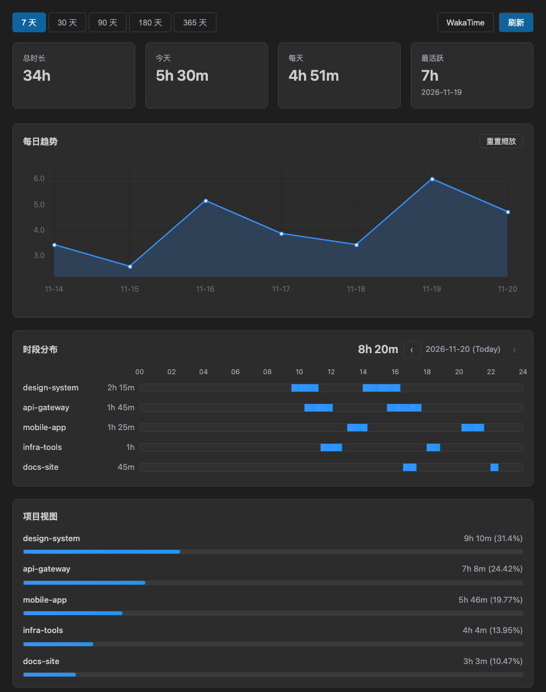

# CodePulse

在 VS Code 内查看按项目汇总的编码时间，辅助项目成本核算。数据由 WakaTime 采集，本插件负责读取和汇总。


 
 ## 功能
 
 - 查看最近 7 / 30 / 90 / 180 / 365 天的编码数据
 - 按项目汇总总时长与平均每天时长
 - 每日编码时长趋势图（可拖动缩放，点右上角「重置缩放」还原）
 - 项目视图与进度条
 - 抄表辅助：标记已记录日期，支持 VS Code 设置同步
 - 状态栏显示今日编码时长

## 开始使用

1. 安装并登录 [WakaTime for VS Code](https://marketplace.visualstudio.com/items?itemName=WakaTime.vscode-wakatime)，开始采集编码心跳。
2. 在 VS Code 命令面板（`⌘⇧P` / `Ctrl+Shift+P`）运行 `CodePulse: 设置 WakaTime Token`，粘贴 OAuth token。
3. 运行 `CodePulse: Open Dashboard` 打开面板。也可以点击状态栏中的 CodePulse 今日时长。

面板支持 7、30、90、180、365 天范围切换和手动刷新。项目行可展开查看项目趋势、编辑器分布、AI 统计等详情。

## 抄表辅助

在面板的「未记录项目」区域点击「记录完成」，将当前时刻记为上次抄表时间。未记录统计从该日期开始计算，记录日当天的编码也计入未记录时长。标记保存在 VS Code 全局状态中，并可通过 Settings Sync 同步。

## 依赖
 
 本插件依赖 [WakaTime](https://wakatime.com/) 采集编码心跳。WakaTime 从 2026-11-01 起不再允许用 API Key 直连读接口，需改用 OAuth token。

## 凭证

按以下顺序解析，命中即用：

1. 命令 `CodePulse: 设置 WakaTime Token` 保存的值（系统钥匙串，不进 Settings Sync）
2. `~/.wakatime.cfg` 中的 `api_key`（复用 WakaTime 官方插件登录态，方便过渡期）

OAuth token 在 [wakatime.com/oauth](https://wakatime.com/oauth) 获取。

设置 Token 命令会安全保存凭证；再次运行可更新凭证。若未设置该值，插件会尝试读取 `~/.wakatime.cfg` 中的 `api_key`。
 
 ## 配置
 
 | 配置项 | 类型 | 默认值 | 说明 |
 |--------|------|--------|------|
| `codepulse.minProjectDurationMinutes` | number | `10` | 忽略编码时长低于该值（分钟）的项目统计。设为 `0` 表示不过滤。 |
| `codepulse.showUnrecordedProjects` | boolean | `false` | 是否显示「未记录项目」模块与「记录完成」按钮。 |

在 VS Code `settings.json` 中按需调整：

```json
{
   "codepulse.minProjectDurationMinutes": 10,
   "codepulse.showUnrecordedProjects": false
}
 ```
 
 ## 需求文档
 
 详见 [docs/spec.md](https://github.com/BWrong/CodePulse/blob/main/docs/spec.md)。
